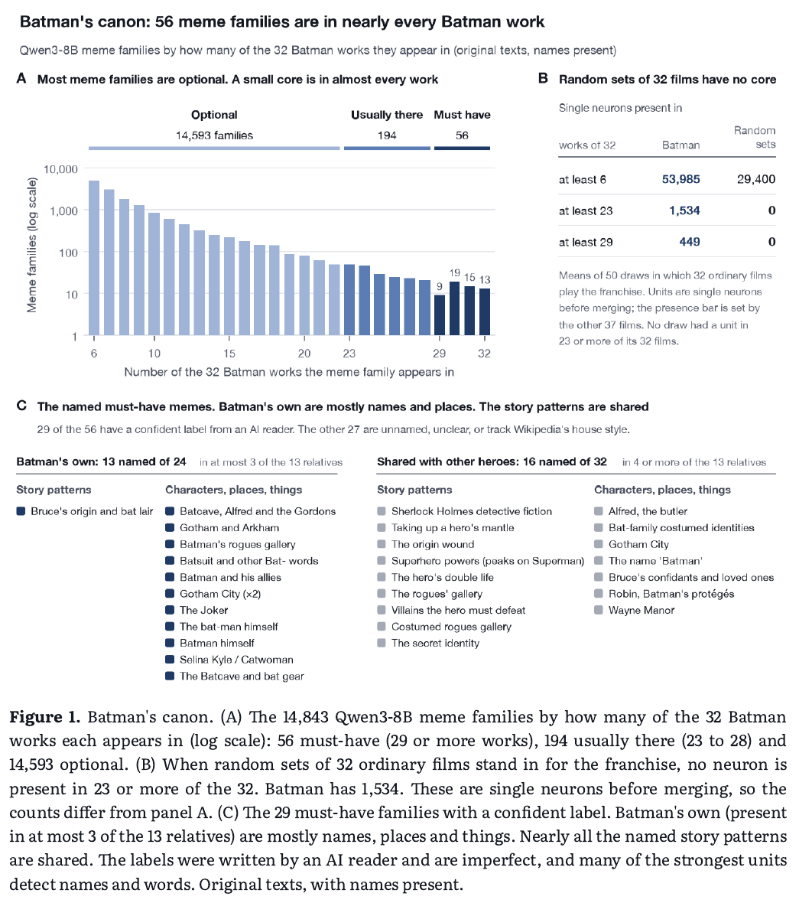

# Can Creativity Be Reverse-Engineered? Language-model neurons as units of cultural inheritance in 80 years of Batman

**Authors:** Mike Taylor, Claude Opus 5.5 (Anthropic)
**Published:** 2026-10 · Source: preprint PDF shared by the authors (20 October 2026)
**Lens:** `generic` · **Digested:** 2026-10-21

## TLDR

Mike Taylor and Claude Opus 5.5 test whether single language-model neurons can be the "unit" memetics never found, defining a meme as whatever makes one neuron fire. They recorded 884,736 neuron poles in Qwen3-8B, with Llama 3.1 8B as an independent replication. The texts were Wikipedia plot summaries of 32 Batman works (1943 to 2022), 13 literary and superhero relatives and 69 ordinary films, 3,700 sentences in all. Neurons that fire on the same sentences were merged into 14,843 meme families. Batman has a real core canon of 56 families present in at least 29 of 32 works, while random 32-film pseudo-franchises have no unit present in even 23 of their films. Of three pre-registered tests on name-free texts, only heredity passed. Adaptations carry their documented source comic's optional units more than other comics' (only 16% of eligible comics beat the source in Qwen and 10% in Llama, against 47% by chance, exact p = 0.0026 and 0.00017), and this holds in 99.6% of 30,240 analysis specifications. But plain TF-IDF word overlap found the sources just as well (11%). With word similarity regressed out, Qwen's neurons added nothing detectable (p = 0.09 to 0.25) and Llama's added a little (p = 0.010 to 0.033). Identity failed. Canon share told Batman apart from ordinary films (AUC 0.90 to 0.95) but not from masked-hero films (0.52 to 0.54), where a TF-IDF centroid reached 0.80 on crime-city words like asylum, henchmen and hostage. The name-free core turned out to be the textbook superhero template (secret identity, origin in loss, costume, mission by night). Selection showed nothing (ρ = 0.25, p = 0.35), in a test with only 27% power to detect a correlation of 0.3. The 33 strongest Qwen memes have Llama "twin" neurons at a median r of 0.82 (0.40 across all 14,843 families), but most of those 33 are name or word detectors and fall to 0.14 once names are removed. Only a handful (a funeral, Two-Face's coin flip, and Llama's revenge unit, which picked the revenge sentence in 10 of 12 pairs written without revenge words) survive rewording. The authors also admit that file timestamps alone cannot prove the pre-registration came before the run. The useful takeaway is that neuron memes make cultural inheritance countable, inspectable and nameable, but on this corpus they trace it no better than word counts, so their added value still has to be shown on lineages where the wording changes and the ideas stay, such as cross-language or loose Shakespeare adaptations.

## Key Takeaway

Looking inside an AI model for the "genes" of a story turned out to work about as well as counting words, and no better. Neurons in an 8-billion-parameter model did trace which comic each Batman film adapted. Plain TF-IDF word overlap found the sources just as well (11% of rival comics beat the true source, against 16% for Qwen's neurons and 10% for Llama's), and once shared words were regressed out, Qwen's neurons no longer pointed to the sources (p = 0.09 to 0.25) while Llama's kept only a narrow edge (p = 0.010 to 0.033). Strip the names and the neuron canon can't tell Batman from other masked-hero films (AUC 0.52 to 0.54), while the humble word counter can (0.80). That's because the name-free core (a secret identity, an origin in loss, a costume, a mission by night) is carried by 91% of the hero-film cousins, while Batman's name-free summaries stand out through a crime-city vocabulary (asylum, police, henchmen, hostage), alongside his named characters and places.

## Implications

- **Run plain word counts before crediting neurons with "seeing ideas"**: On the heredity test, TF-IDF cosine found the documented source comic slightly better than Qwen's neurons did (11% of comics beat the source, against 16%). TF-IDF also passed the sequel control that Qwen missed. If you evaluate any interpretability unit, run the cheap keyword baseline on the same texts first, and claim extra value only after a residual test like the one that failed for Qwen (p = 0.09 to 0.25) and passed narrowly for Llama (p = 0.010 to 0.033).
- **Strip names before trusting that two models agree on concepts**: The strongest Qwen units had Llama twins at a median r of 0.82, but 24 of those 33 were name or place detectors. On name-free texts the same pairs fell to 0.14, which is worse than units matched on word use (0.56). Any "models converge on the same concepts" claim should be tested on scrubbed or reworded inputs.
- **Treat AI-written neuron labels as hypotheses to check**: Blind judges matched labels to new sentences 79% of the time, but a judge that only compared words got 65%. For the 31 named memes the gap was not significant (77% against 63%). The "Lucius Fox" neuron also fired on Zorro's nickname "The Fox", and no label was validated by steering. So check labels on held-out sentences against a word-overlap baseline before building on them.
- **Use neuron units as a fast, inspectable trait inventory, not yet as a better detector**: The pipeline pulled 14,843 meme families automatically from 3,700 sentences. Each unit has an address and comes with its strongest examples. Heredity held in 99.6% of 30,240 analysis specifications. That makes it a fast, automatic alternative to fixed hand-coded trait lists. The paper did not compare it with one, and on this corpus it traces inheritance only about as well as word counts.
- **Look for a franchise's identity in its world as well as its plot template**: Without names, the share of Batman's canon a work carried could not tell Batman from superhero films (AUC 0.52 to 0.54). A TF-IDF centroid could (0.80), through crime-city words like asylum, police, henchmen and hostage. The name-free core the neurons found (secret identity, origin in loss, costume, mission by night) is basically the textbook definition of a superhero. It is not a Batman signature.
- **Test on lineages where the wording changes and the ideas stay**: The authors say themselves that Wikipedia summaries of a comic and its film share vocabulary, so word overlap rarely loses the trail. If you want to show that a semantic method beats keywords, try cross-language pairs, staged vocabulary drift, loose Shakespeare adaptations, or planted memes with decoys. These are the designs the paper lists as next steps, and none has run yet.
- **Read the deviations section before taking the verdict table at face value**: The E2 placebo criterion fails as written with all 11 targets and passes only with the 9 valid ones. E2's frequency band and hub adjustment were chosen after an earlier heredity test failed, and all 132 multiverse failures had the hub adjustment switched off. The authors also admit that file timestamps cannot confirm the pre-registration order. The result is still robust, but the "pre-registered" label carries less weight than it first appears to.
- **Don't treat the selection null as evidence against selection**: E3 had only 15 early works and would catch a true correlation of 0.3 just 27% of the time. It also measured popularity from 2015 to 2026 rather than at release. Popular early Batman works may still spread their memes further, and testing that needs a larger lineage, success measured when each work came out, and a random-copying baseline.

## How to Apply It (method)

**Scenario:** A literary research group (or a studio's development team doing comparables work) wants to test a long-argued claim with numbers. The claim is that loose screen adaptations really inherit the story ideas of the play they adapt, even after names, settings and wording have all changed. Examples include *10 Things I Hate About You* and *The Taming of the Shrew*, *West Side Story* and *Romeo and Juliet*, *The Lion King* and *Hamlet*, *She's the Man* and *Twelfth Night*, and *Ran* and *King Lear*. The paper lists this exact lineage as its own next experiment. The reason is that on Batman, plain word counts found sources about as well as neurons did. Loose Shakespeare adaptations are a case where shared wording should not carry the signal. If the neurons add anything, it should show up here.

**Steps:**

1. **Assemble the corpus and the documented sources**: Pull the plot section of the English Wikipedia article for each work and keep the first 40 sentences. Drop any summary under 8 sentences. Build four groups.
   - **Lineage targets**: 20 to 40 screen adaptations, from near-literal (Branagh's *Hamlet*) to loose (*The Lion King*).
   - **Candidate sources**: all the plays that have usable summaries.
   - **Non-adapting screen works**: 10 or more films in the same genres (teen romcoms, crime dramas, family animation) that adapt no play. These are used for the "hub" correction in step 8.
   - **Background pool**: about 70 popular films with no Shakespeare link. These set the bar every unit is measured against.

   Record each adaptation's documented source(s) and a strength-of-attribution flag in a spreadsheet *before* computing anything.

2. **Build a name-free version of every text**: Have an LLM rewrite each summary with proper names replaced, then have a second pass check the rewrite. Use the rewrite only to *find* names. Run a word-level diff against the original, and replace each changed span in the original with a neutral code (X1, X2, ...) that stays consistent within a work. Do not keep the rewriter's own wording. The paper found the rewriter's role words leaked identity ("the vigilante" appeared 366 times in Batman rewrites and never in ordinary films). Check by hand that the diff did not swallow nearby words.

   ```
   Rewrite the plot summary below, replacing every proper name (people,
   places, organisations, titles of works) with a short generic description.
   Change nothing else. Keep sentence order and sentence count identical.

   SUMMARY:
   [paste summary]
   ```

   Then a second pass:

   ```
   Compare ORIGINAL and REWRITE sentence by sentence. List any proper name
   still present in REWRITE, and any sentence where content other than names
   was changed. Output JSON: {"missed_names": [...], "altered_sentences": [...]}.
   ```

3. **Record neuron activations in two independent models**: Run Qwen3-8B as the primary model and Llama 3.1 8B (a different company and different training data) as the replication. The paper ran both locally at 4-bit with MLX. Hugging Face transformers with forward hooks also works. A unit is one channel of each MLP block's hidden layer, meaning the SwiGLU product that feeds `down_proj`. Treat the positive and negative extremes of each channel as two separate units, since sign is arbitrary. Process each text as one continuous document, and store each unit's maximum activation in every sentence. Do this for both the original and the name-free texts.

4. **Score works and define presence**: Use this rule throughout.

   ```
   score(work, unit)   = mean of the unit's 3 highest sentence activations in that work
   present(work, unit) = score(work, unit) > all but one of the background films' scores
   ```

   An unrelated story crosses this bar about 3% of the time by chance.

5. **Find candidate memes, merge them into families, and name them**: Keep units present in at least about 19% of lineage works (the paper used 6 of 32). Merge units whose sentence-level activation profiles correlate at 0.5 or more, using average-linkage clustering. Name each family by reading its 8 strongest sentences. Then have a second, sceptical reader challenge every name, and flag families that only detect a word, a name or Wikipedia house style (cast lists, release history). Keep those flagged families in all analyses rather than deleting them.

   ```
   Below are the 8 sentences that most strongly activate one unit in a
   language model. Propose the narrowest label that covers all 8. Then say
   whether the unit looks like (a) a story concept, (b) a character or place
   name, (c) a single word or phrase, or (d) Wikipedia formatting. Give one
   sentence you would expect it NOT to fire on even though it shares words.

   [8 sentences, each tagged with its source work]
   ```

   Sceptic pass: "Here is a label and the 8 sentences. Name any sentence the label does not explain, and propose a narrower or broader label if one fits better."

6. **Pre-register the heredity test before running it**: Write down the primary model, the primary statistic, the predicted direction and threshold, the falsifying result, and every control in step 8 to step 11. If possible, have two or three independent reviewers (human or AI) try to break the design, and revise it once. Commit the file with a timestamp. The paper notes that its own file times could not prove this order, so use version control from day one.

7. **Define the optional units used for inheritance**: For heredity, use units present in a middle band of lineage works (the paper used 2 to 16 of 32, roughly 6% to 50%). Very common units say "this is a story" and very rare ones are noise.

8. **Run the heredity test on name-free texts**: For each adaptation A and each candidate play C, compute the following.

   ```
   rate(A, C) = |optional units present in C AND present in A| / |optional units present in C|

   z(A, C)    = (rate(A, C) - mean_N rate(N, C)) / sd_N rate(N, C)
                where N ranges over the non-adapting screen works
                (this "hub adjustment" stops plays that resemble everything from winning)

   beat(A)    = share of eligible plays C (C != source) with z(A, C) > z(A, source(A))
                using the best-scoring source if A has several

   statistic  = mean of beat(A) over all adaptations
   ```

   Lower is better. Get the p value by relabelling play identities jointly, either 10,000 random draws or an exact enumeration if the count is small. The paper's chance level was about 47% of rivals beating the source. Also run two stricter nulls. The first swaps source sets among the adaptations. The second gives the source sets to random non-adapting films.

9. **Run a positive control and placebos**: As a positive control, where several films adapt the same play (multiple *Romeo and Juliet* films), each should rank its sibling among its top 2 matches for most pairs. If this fails, call a failed main test inconclusive rather than falsified. As placebos, give each documented source set to each non-adapting film. The real statistic should fall below the 5th percentile of those placebo values. For an upper bound, run the same test on the original texts, and on near-literal adaptations alone.

10. **Run the word baselines and the residual test**: This step decides whether neurons add anything. Run the identical test with TF-IDF cosine and with binary word presence on the same name-free texts. Then, across all adaptation-by-play pairs, regress neuron inheritance on word similarity and rerun step 8 on the residuals. Keep two claims separate. The first is that the adaptations carry their sources by any measure. The second is that neurons see more than words, and only the residual test shows that. Also run the reverse, regressing neurons out of TF-IDF.

11. **Stress-test with a multiverse and a jackknife**: Vary the score rule (top 1, 3 or 5 sentences), the presence bar, the frequency band, the hub adjustment on or off, and the source rule (best, mean or first-listed). Do this in both models and on both text versions, and report the share of specifications with p below 0.05. Leave out every single adaptation, every pair, every triple and every single play, and report the worst p.

12. **Check whether named units track ideas or words**: For each named family, rewrite its top sentence so it shares no content words with the original. A unit "survives" if it fires harder on the rewording than on any of ten everyday sentences. Compare the survival count with a mismatched null that scores each unit on another family's rewording (the paper got 11 of 31 survivors against about 5 expected). Separately, run a blind label test. Give a judge a label plus two corpus sentences. One is a strong hit the labeller never saw (activation rank 9 to 30). The other is a length-matched control from the same works at or below the unit's median. Compare the judge's accuracy with a word-overlap judge that picks whichever sentence shares more word stems with the label, and keep item-level answers so the comparison can be paired.

    ```
    A neuron is described as: "[label]".
    Which of these two sentences does it respond to more strongly?
    A: [sentence]
    B: [sentence]
    Answer with A or B only.
    ```

13. **Find cross-model twins**: For each Qwen family, find the Llama unit whose activations across all corpus sentences correlate most strongly with it. Compare against non-meme Qwen units matched on sparsity and on how well a single word reproduces their profile. Then recompute the same twin pairs on name-free texts. The paper's strongest twins (median r = 0.82) were mostly name detectors and fell to 0.14 without names. Treat agreement that survives name removal as the interesting result.

14. **Interpret with pre-set decision rules**: There are three possible readings. If neurons find sources but fail the residual test, the adaptations inherit wording-level content and a keyword tool would do. If neurons pass the residual test and TF-IDF fails on the loose adaptations, you have evidence that the units track ideas words miss, which is the result the Batman paper could not show. If both fail on loose adaptations, the "inheritance" in loose adaptations is too abstract for this unit.

**Expected outcome:** You end up with a named, inspectable inventory of story units for the Shakespeare lineage, each with a model address (layer, neuron, pole), its strongest example sentences, and a blind-tested label. You also get a heredity score saying how close each adaptation sits to its documented play compared with every other play, with exact p values, a multiverse pass rate and a worst-case jackknife. Most importantly, you get a direct head-to-head between neurons and word counts on a lineage where words should fail. On the paper's Batman corpus, word counts traced sources about as well as neurons (TF-IDF 11% of rivals beating the source against Qwen's 16% and Llama's 10%), and only Llama passed the residual test (p = 0.010 to 0.033). Your result will show whether that tie was an artefact of Wikipedia summaries sharing wording, or a real ceiling on what single neurons add. Either way, you will know whether to keep neuron units for tracing influence or fall back on cheaper keyword methods.

## Best Figure



Image Candidates:
Figure 1 (p. 8): Shows in one view that a 56-family core canon exists in nearly every Batman work while random 32-film pseudo-franchises have no core at all, and that most of the named story patterns in that core are shared with other superheroes.
Figure 7 (p. 16): Plots, for each of 9 adaptations in both Qwen3-8B and Llama 3.1 8B, where the documented source comic ranks among eligible comics by inherited units, which makes the paper's one supported pre-registered result (heredity) visible at a glance.
Figure 6 (p. 15): Contrasts name-free canon-share AUCs against ordinary films (0.90 to 0.95), literary ancestors (0.89 to 0.95) and masked-hero films (0.52 to 0.54) against the pre-registered 0.80 bar, showing exactly where the identity test fails.

Best Image:
Figure Name: Figure 1: "Batman's canon"
Figure Page: 8
Slide Caption: Batman has 56 meme families present in nearly every work, while random 32-film pseudo-franchises have no core at all.
Description: Figure 1 has three panels. Panel A sorts the 14,843 Qwen3-8B meme families (each defined by neurons that fire on the same sentences) by how many of the 32 Batman works they appear in, on a log scale. It splits them into 14,593 optional families, 194 that are "usually there" (23 to 28 works) and 56 "must-have" families (29 or more works). Panel B is the key baseline. When 50 random sets of 32 ordinary films stand in for a franchise, they average 29,400 single neurons present in at least 6 films (Batman has 53,985) and zero neurons present in 23 or more films (Batman has 1,534), so the core canon is not an artefact of the method. Panel C lists the 29 must-have families with a confident label. Batman's own 13 are mostly names, places and things (Gotham, Alfred, the Joker, the Batcave). Of the 16 shared with other heroes, most are story patterns such as the secret identity, the origin wound and taking up a mantle. That split foreshadows the paper's later findings. The distinctive part of Batman is largely names and words, and the story-level core is closer to the generic superhero, which is why the name-free identity test fails against hero films. One caveat is that this figure uses original texts with names present, and the authors note the labels were written by an AI reader and that many strong units detect names and words.

## What Experts Overlook

The heredity result depends partly on two design choices in experiment E2, chosen after an earlier tree test failed, that strip out what a story shares with the rest of the franchise. First, only "optional" units count. These are units present in 2 to 16 of the 32 Batman works, so the 56 core memes that nearly every Batman story carries cannot make every comic look like the source of every film. Second, each comic's inheritance rate is z-scored against the same rate in the 11 Batman screen works that adapt no comic, which the authors say "corrects for comics that resemble everything." The paper shows what is at stake twice. An earlier tree test compared works on their full meme sets. It put the documented source comic at a mean rank of 5.4 out of 12, against 5.8 by chance, a clean failure. And in the 30,240-specification multiverse, all 132 specifications that failed had the hub adjustment switched off. With it on, the worst p was 0.020, and since only 132 of 30,240 specifications fail, most hub-off specifications still pass.

**Why it matters:** You might assume heredity shows up because model neurons capture deep narrative concepts. The controls say otherwise. Plain TF-IDF and binary word presence pass the same test (11% and 17% of eligible comics beat the source, against 16% for Qwen). For Qwen the signal disappears once word similarity is regressed out (p = 0.09 to 0.25). Much of the work is done by the comparison logic. A frequency band throws away shared canon, and a baseline penalises source candidates that look like everything. On E2, word counts do as well as the neurons, though in the earlier tree test TF-IDF (mean rank 2.9) and even random non-meme units found the sources where the memes did not. There is a caveat the authors state openly. The band and the hub adjustment were chosen after the tree test failed, so the multiverse "limits that risk but cannot remove it." The lesson you can carry to other work is that lineage shows up in rare shared traits, measured against how generic a candidate source already is.

**Example of good use:** A team wants to know which of five competitor launch posts a new rival's landing page borrowed from. They don't rank raw similarity. They keep only claims and phrasings that appear on a minority of pages in the category. Then they score each competitor post against its overlap with unrelated pages that could not have copied it. The category leader, whose language is close to every page, no longer wins by default. The real source rises to the top, because it shares a distinctive pricing frame and one specific rebuttal to an objection.

**Example of misapplication:** An analyst asks the same lineage question using full feature sets and no baseline. Every new page looks closest to the market leader, because it shares the category's generic vocabulary ("seamless", "AI-powered", "built for teams"). The paper's earlier tree test, which compared full meme sets without a frequency band or baseline, failed to recover the sources (mean rank 5.4 of 12 against 5.8 by chance). The paper does not say why. The second trap is worse. Suppose the analyst tunes the band and the baseline after a failure, reports a single specification, and presents the result as proof that an expensive embedding model "understands" influence. Without a word-count comparator run alongside, nobody would notice that simple word overlap finds the sources just as well. The costly method then gets credit it has not earned.

## Extracted Prompts

The paper itself prints no prompts. It says the name-free rewrites, meme labels, scepticism passes and blind label judging were done by language models, but the prompt texts are not given. The illustrative prompts in the method section above are this digest's reconstructions, not the authors' wording.

## Citations

26 references extracted (full list in frontmatter). First 10:

- Richard Dawkins (1976). The selfish gene
- Robert Aunger (2000). Darwinizing culture: the status of memetics as a science
- Bruce Edmonds (2005). The revealed poverty of the gene-meme analogy: why memetics per se has failed to produce substantive results
- Alex Mesoudi, Andrew Whiten, Kevin N. Laland (2006). Towards a unified science of cultural evolution
- Jamshid J. Tehrani (2013). The phylogeny of Little Red Riding Hood
- Sara Graça da Silva, Jamshid J. Tehrani (2016). [Comparative phylogenetic analyses uncover the ancient roots of Indo-European folktales](https://doi.org/10.1098/rsos.150645)
- Gabriel Goh, Nick Cammarata, Chelsea Voss, et al. (2021). Multimodal neurons in artificial neural networks
- Wes Gurnee, Theo Horsley, Zifan Carl Guo, et al. (2024). Universal neurons in GPT2 language models
- Minyoung Huh, Brian Cheung, Tongzhou Wang, et al. (2024). The platonic representation hypothesis
- Nick Cammarata (n.d.). [Neural networks are already clean](https://already-clean.goodfire.com)

## Related Digests

None yet. This is the first paper in the `memetics` corpus.

## Reviewer Notes

**Overall severity:** Minor fact tweak

Every number in the draft was checked against the paper text, Tables 2 and 3, and the Figure 1 image on page 8, and all of them matched. Five framing claims went further than the paper and were corrected in place.

- **Twin correlations** (TLDR). The draft said cross-model twin neurons correlate at a median r of 0.82. That figure applies only to the 33 strongest Qwen memes. Across all 14,843 families the median is 0.40. *Fixed.*
- **What makes Batman Batman** (Key Takeaway). The draft said the core traits, including "the cape", are shared by every superhero and that the crime city is what makes Batman Batman. No cape unit is reported, the name-free core is present in 91% of hero-film cousins (not every superhero), and the paper describes Batman as layered, with the template underneath and named characters, places and a crime-city vocabulary on top. *Fixed.*
- **"Practical replacement" for hand-coded traits** (Implications). The paper never compares neuron units with a hand-coded trait list. *Reworded to "fast, automatic alternative", with that caveat.*
- **"The heredity result does not come from the neurons"** (What Experts Overlook). Overstated. Only 132 of 30,240 specifications fail, so most hub-off specifications still pass, and in the earlier tree test TF-IDF (rank 2.9) and random non-meme units found the sources where the memes did not, so the unit did matter there. *Softened to "depends partly on two design choices", with the tree-test contrast added.*
- **"Core canon drowned out the source signal in the tree test"** (What Experts Overlook). The paper reports the tree test failure (mean rank 5.4 in Qwen, 5.3 in Llama, against 5.8 by chance) but gives no cause. *Replaced with what the paper actually reports.*

Also noted at assembly, before review. The key takeaway subagent's draft omitted that Llama passes the residual test narrowly (p = 0.010 to 0.033) and said "Spider-Man" where the paper reports masked-hero films as a group. Both were corrected before the check ran. The prompts in the method section are this digest's reconstructions, since the paper prints none.
